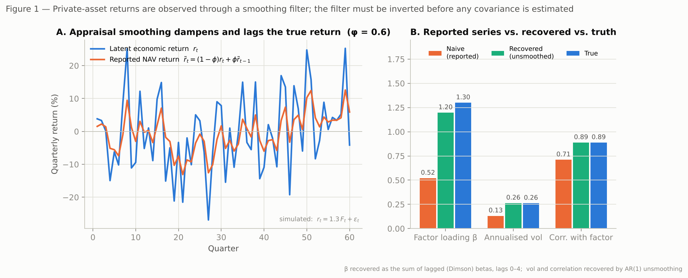
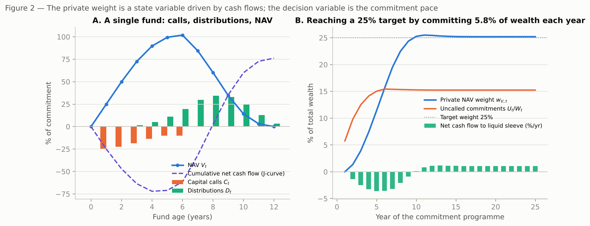
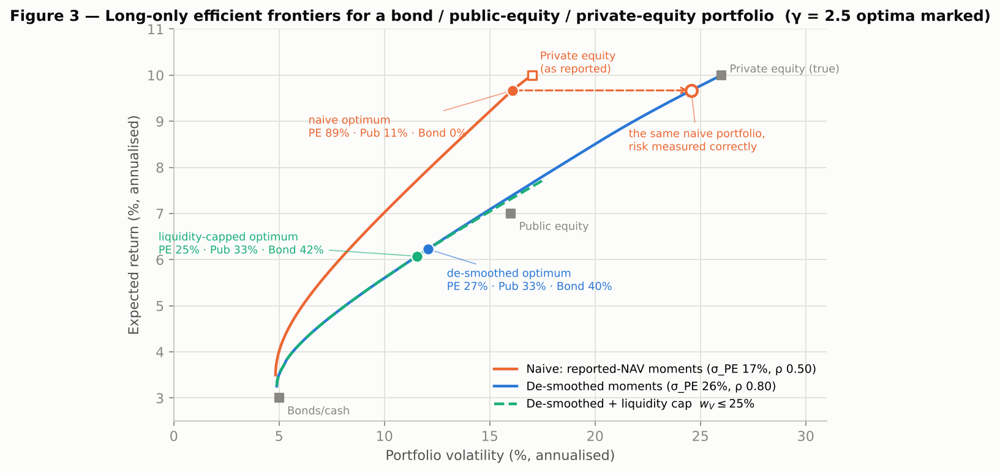
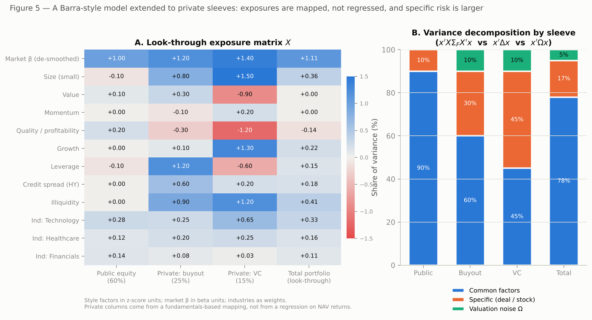
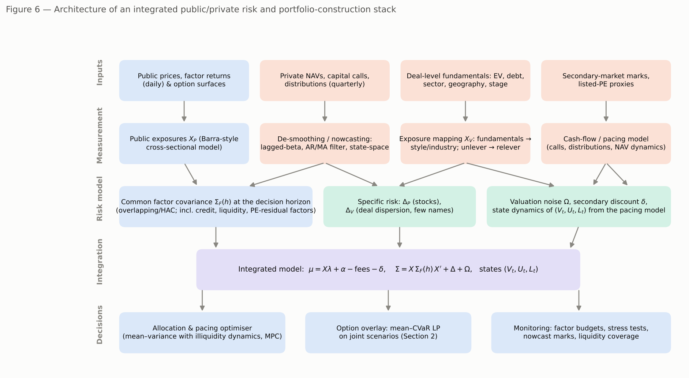

# A Mean–Variance Framework Alternative for Mixed Public / Private Equity Portfolios

---

## Executive summary

Markowitz optimization assumes that every holding has an observable market return, that any position can be rebalanced at will, and that risk is adequately summarized by the second moment of returns measured over a common horizon. A portfolio that mixes listed equities with non-traded private equity violates all three assumptions: private returns are observed only through appraisal-based net asset values (NAVs) that smooth and lag true value; private positions are built through capital commitments that are called and distributed on the general partner's schedule; and the accounting marks understate volatility and co-movement with public markets so badly that a naive optimizer will systematically over-allocate to private assets.

This note sets out:

1. **A rigorous framework (Section 1).** We treat each private holding's economic return as a latent process observed through a known smoothing filter, estimate its factor loadings and residual risk from the *inverted* filter and from cash flows, align all moments to a common decision horizon, and add two terms Markowitz does not have — a valuation-uncertainty block $\Omega$ and a set of **state equations** for commitments, calls, distributions and NAV. The private weight becomes a state variable; the controls are public trades, new commitments and (expensive) secondary sales. The resulting problem is a convex multi-period mean–variance program with a liquidity chance constraint, solved by receding-horizon (model-predictive) control. With no smoothing, no commitment lag and no liquidity constraint it collapses exactly to Markowitz.

2. **An optimal hedging problem with vanilla options (Section 2).** Options can only hedge the *systematic* part of a private sleeve, and only against the *economic* value, not the NAV. We define a static mean–CVaR hedge over a joint scenario set for public factors, de-smoothed private returns and cash flows; the representation shown turns it into a linear program that is convex, scalable and reliable. In the worked example (Figure 4) a collar of 0.55 units of at-the-money puts financed by writing 0.60 units of 105 % calls on the equity index cuts the one-year 95 % expected shortfall of a 60/40 public/private portfolio from 33.9 % to 17.4 % of wealth at a cost of one percentage point of expected return.

3. **Risk-factor models for the mixed portfolio (Section 3).** Barra-style models *can* be extended to private holdings, but the exposures must be **mapped from fundamentals rather than regressed from returns**, the factor covariance must be expressed at the private assets' horizon, specific risk must reflect deal-level dispersion, and a residual "pure-private" factor and a liquidity/commitment factor must be added. We describe an identification procedure and a management toolkit (look-through budgets, completion portfolios, overlay hedges, nowcast marks, stress tests).

---

## 0. Setting and notation

| Symbol | Meaning |
|---|---|
| $t = 0,1,\dots$ | decision dates (quarterly); $h$ = decision horizon in periods; $H$ = planning horizon |
| $L_t$ | liquid reserve (cash and short bonds) |
| $P_t \in \mathbb{R}^{N_P}$ | market values of public equity positions; $\tau_t$ = trades executed at $t$ |
| $V_{j,t}$ | **economic** value of private holding $j = 1,\dots,N_V$ (a fund, vintage or deal); $\tilde V_{j,t}$ = reported NAV |
| $U_{j,t}$ | uncalled commitment to holding $j$; $K_{j,t}$ = new commitment made at $t$ |
| $C_{j,t},\ D_{j,t}$ | capital calls and distributions during period $t$ |
| $W_t = L_t + \mathbf 1'P_t + \mathbf 1'V_t$ | total economic wealth; $x_t = (x_{L,t}, x_{P,t}, x_{V,t})$ = weights |
| $f_t \in \mathbb{R}^{K}$ | returns on common risk factors (market, style, industry, credit, liquidity, …) |
| $\lambda$, $\Sigma_F(h)$ | factor premia and factor covariance over $h$ periods |
| $r^P_t,\ r^V_t,\ \tilde r^V_t$ | public returns, latent private economic returns, reported NAV returns |
| $\gamma$ | risk aversion; $\alpha \in (0,1)$ = CVaR confidence level |

Lower-case $x$ denotes weights, upper-case $X$ an exposure matrix. "Private equity" covers buyout, growth and venture funds as well as direct/co-investments; the framework is written at the level of a *holding* $j$, which can be a fund, a vintage-year bucket or a single deal depending on data granularity.

---

## 1. Mathematical definition of a rigorous quantitative portfolio framework

### 1.1 Why Markowitz cannot be applied directly

Classical mean–variance optimization solves

$$
\max_{x}\; \mu' x - \frac{\gamma}{2} x' \Sigma x \quad \text{s.t.}\quad \mathbf 1' x = 1,\; x \ge 0 ,
\tag{1.1}
$$

with $\mu$ and $\Sigma$ estimated from observed returns and with $x$ freely chosen each period. For private holdings four things break:

1. **The return is not observed.** NAVs are appraisals updated quarterly with reference to lagged public comparables; the reported return $\tilde r^V_t$ is a moving average of the true return $r^V_t$. Variance and covariance with public markets estimated from $\tilde r^V$ are biased downward (Figure 1).
2. **Weights are not controls.** The investor chooses *commitments*; capital is called over 3–6 years and returned over 8–14 years. The private weight $x_{V,t}$ is a state driven by cash flows and returns (Figure 2).
3. **Horizons differ.** Public risk is naturally measured daily or monthly; private exposures only reveal themselves over multi-quarter horizons. Moments must be aligned to a common horizon $h$.
4. **Marks are not prices.** The NAV differs from fair value by a secondary-market discount that widens in stress; and idiosyncratic risk in a fund of 10–20 companies is far from diversified.

Each of these is addressed by one component below; the components combine into a single convex programme (Section 1.6).

### 1.2 Observation model for private returns and its inversion

**Latent return.** For each private holding $j$ the economic (log) return per period is modelled through the common factors:

$$
r^V_{j,t} = \alpha_j + \beta_j' f_t + \varepsilon_{j,t}, \qquad \varepsilon_{j,t} \sim (0, \sigma^2_{\varepsilon,j}),
\tag{1.2}
$$

where $\beta_j$ is the *economic* factor loading (e.g. an equity beta of 1.2–1.4 for buyout after leverage) and $\alpha_j$ is the net-of-fees premium not spanned by public factors.

**Smoothing filter.** The reported NAV return is a weighted average of current and past true returns plus reporting noise (Getmansky–Lo–Makarov, 2004):

$$
\tilde r^V_{j,t} = \sum_{k=0}^{q} \theta_{j,k}\, r^V_{j,t-k} + \eta_{j,t}, \qquad \sum_{k=0}^q \theta_{j,k} = 1,\; \theta_{j,k} \ge 0 .
\tag{1.3}
$$

The appraisal-smoothing case is the geometric special case $\theta_k = (1-\phi)\phi^k$, i.e.

$$
\tilde r^V_t = (1-\phi)\, r^V_t + \phi\, \tilde r^V_{t-1}, \qquad 0 \le \phi < 1 .
\tag{1.4}
$$

Three consequences follow immediately from (1.3): (i) the reported variance is $\mathrm{Var}(\tilde r) = \mathrm{Var}(r)\sum_k \theta_k^2 < \mathrm{Var}(r)$ — under (1.4) the ratio is $(1-\phi)/(1+\phi)$, which for $\phi = 0.6$ halves the volatility; (ii) the contemporaneous regression of $\tilde r$ on $f$ recovers only $\theta_0\beta$, while the *sum* of the loadings on $f_t, f_{t-1},\dots,f_{t-q}$ recovers $\beta$ (Dimson, 1979; Asness–Krail–Liew, 2001); (iii) spurious positive autocorrelation appears in $\tilde r$ with first-order coefficient $\approx \phi$.

**Inversion (de-smoothing).** The framework requires one of the following estimators of $(\beta_j, \sigma_{\varepsilon,j})$ and of the unsmoothed series — in increasing order of sophistication and data requirement:

* *Lagged-beta regression:* $\hat\beta_j = \sum_{k=0}^q \hat b_{j,k}$ from $\tilde r^V_{j,t} = a + \sum_{k=0}^{q} b_{j,k}' f_{t-k} + u_t$. Robust, needs only NAV returns and public factor returns; $q$ = 2–4 quarters in practice.
* *AR/MA inversion:* $\hat r^V_t = (\tilde r^V_t - \hat\phi\, \tilde r^V_{t-1})/(1-\hat\phi)$ under (1.4), or the MA($q$) inversion of (1.3). Recovers the full series for covariance estimation. Couts–Gonçalves–Rossi (2024) show that funds in the same asset class share a *common* lagged component that single-fund inversion misses; their three-step procedure adds the lagged *aggregate* return of similar funds to the filter.
* *State-space / nowcasting:* treat $r^V_{j,t}$ as a latent state, $\tilde r^V$ and cash flows as observations, and estimate by Kalman filtering/MCMC at weekly or monthly frequency (Brown–Ghysels–Gredil, 2023). Delivers a *current* economic value $\hat V_{j,t}$ between reporting dates — the object the hedge in Section 2 must protect.
* *Cash-flow-based identification:* estimate $(\alpha_j,\beta_j)$ by requiring that the NPV of calls and distributions discounted at $r_f + \beta' f + \alpha$ be zero on average. These do not use NAVs at all and are the natural prior for $\alpha$.

Figure 1 illustrates the mechanics on simulated data: with $\phi = 0.6$ the contemporaneous beta is 0.52 against a true 1.30, reported volatility is 13 % against a true 26 %, and the correlation with the factor is 0.71 against 0.89. The summed-lag beta (1.20) and the AR(1) inversion recover the truth to within sampling error.

### 1.3 Common-factor representation and horizon-aligned moments

Both sleeves are represented through the same factor set:

$$
\begin{pmatrix} r^P_t \\ r^V_t \end{pmatrix}
= \begin{pmatrix} \alpha_P \\ \alpha_V \end{pmatrix}
+ \begin{pmatrix} X_P \\ X_V \end{pmatrix} f_t
+ \begin{pmatrix} u^P_t \\ \varepsilon^V_t \end{pmatrix},
\qquad X \equiv \begin{pmatrix} X_P \\ X_V \end{pmatrix} \in \mathbb{R}^{(N_P+N_V)\times K}.
\tag{1.5}
$$

$X_P$ comes from the public risk model (Section 4); $X_V$ from the de-smoothing estimators above and from fundamentals mapping (Section 4.2). Because private positions cannot be rebalanced within the period, risk is measured over the decision horizon $h$ (one to four quarters) using the covariance of *cumulative* factor returns,

$$
\Sigma_F(h) = \mathrm{Var}\!\Big(\sum_{s=1}^{h} f_{t+s}\Big)
= \sum_{\ell=-(h-1)}^{h-1} (h-|\ell|)\, \Gamma_F(\ell),
\tag{1.6}
$$

estimated from overlapping sums with a Newey–West correction rather than as $h\,\Sigma_F(1)$, because several of the relevant factors (credit, liquidity, small-cap) are themselves autocorrelated.

The **integrated moment estimates** at horizon $h$ are then

$$
\mu = \begin{pmatrix} h\, r_L \\ h(\alpha_P + X_P\lambda) \\ h(\alpha_V + X_V\lambda) - \kappa^{\text{fee}} - \pi\,\delta \end{pmatrix},
\qquad
\Sigma = X\,\Sigma_F(h)\,X' + \Delta(h) + \Omega .
\tag{1.7}
$$

Here $\Delta(h) = \mathrm{diag}(\Delta_P, \Delta_V)$ is specific risk; $\Delta_V$ is estimated from the *cross-sectional dispersion of deal outcomes* within a fund (typically 25–40 % per year for a buyout fund's residual, far higher for venture), not from NAV residuals. $\kappa^{\text{fee}}$ is the expected drag of management and carried-interest fees over the horizon (if $\alpha_V$ is estimated net of fees it is already included), and $\pi\delta$ is the probability-weighted secondary-market discount discussed next. The private $\alpha_V$ is shrunk toward zero or toward the cash-flow-based estimate with a Bayesian weight reflecting the precision of the fund-level evidence; the literature in Section 3 shows that post-2005 vintages' net alpha is close to zero on average, with large and partly persistent dispersion across managers.

### 1.4 Valuation uncertainty and the secondary discount

The NAV is a noisy and biased measure of fair value. Write

$$
V_{j,t} = \tilde V_{j,t}\,(1+\nu_{j,t}), \qquad \mathbb E[\nu_{j,t}] = -\delta_{j,t},\quad \mathrm{Var}(\nu_{j,t}) = \omega_{j,t}^2 ,
\tag{1.8}
$$

where $\delta$ is the expected discount to NAV at which the stake could be sold and $\omega$ the dispersion of that discount. Secondary-market evidence (Section 3.3) puts $\delta$ near 5–15 % for seasoned buyout funds in normal markets, 15–25 % in the 2022 repricing, and 40 % or more in 2008–09, with $\omega$ of the same order of magnitude. The framework carries this through two channels:

* in expected return, through $\pi_j \delta_j$ in (1.7), where $\pi_j$ is the probability that the stake is sold before maturity (zero for a hold-to-maturity investor with ample liquidity, close to one for an investor who may be forced to sell);
* in risk, through $\Omega = \mathrm{diag}(0,\, 0,\, \pi_j\,\omega_j^2 \tilde V_j^2 / W^2)$: the valuation noise only matters if it can be *realized*.

This is the first term with no Markowitz counterpart, and it is what makes the framework internally consistent: an investor who treats NAV as price assumes $\pi = 0$ and should then also accept that she cannot rebalance out of the position.

### 1.5 State dynamics: commitments, calls, distributions, NAV, liquidity

For each private holding $j$ (a fund or vintage bucket), with call rate $c_{j,t}$ and distribution rate $d_{j,t}$,

$$
\begin{aligned}
C_{j,t+1} &= c_{j,t+1}\,U_{j,t}, &\qquad U_{j,t+1} &= U_{j,t} - C_{j,t+1} + K_{j,t+1},\\
D_{j,t+1} &= d_{j,t+1}\,V_{j,t}\,(1+r^V_{j,t+1}), &\qquad V_{j,t+1} &= V_{j,t}(1+r^V_{j,t+1}) + C_{j,t+1} - D_{j,t+1} - S_{j,t+1},
\end{aligned}
\tag{1.9}
$$

where $S_{j,t+1} \ge 0$ is a secondary sale (realised at $(1-\delta)$ times value). The liquid and public sleeves evolve as

$$
\begin{aligned}
L_{t+1} &= L_t(1+r^L_{t+1}) - \mathbf 1' C_{t+1} + \mathbf 1' D_{t+1} + (1-\delta)\mathbf 1' S_{t+1} - \mathbf 1'\tau_t - c(\tau_t) - O_{t+1},\\
P_{t+1} &= (P_t + \tau_t)\circ(1 + r^P_{t+1}),
\end{aligned}
\tag{1.10}
$$

with $O_{t+1}$ exogenous outflows (spending, benefit payments) and $c(\cdot)$ a convex transaction-cost function. The **controls** are $(\tau_t, K_t, S_t)$; the **states** are $(L_t, P_t, V_t, U_t)$. Figure 2 shows the implied dynamics: a single fund's J-curve, and a commitment program in which committing 5.8 % of wealth each year reaches a 25 % steady-state private weight with uncalled commitments of about 15 % of wealth outstanding at all times.

The liquidity requirement is a **chance constraint** on the reserve:

$$
\mathbb P\big( L_{t+1} \ge \ell\,W_{t+1} \big) \ge 1-\epsilon
\quad\Longleftrightarrow\quad
\mathbb E[L_{t+1}] - z_{1-\epsilon}\,\sigma(L_{t+1}) \ge \ell\, \mathbb E[W_{t+1}]
\tag{1.11}
$$

under a normal approximation (or its scenario-based CVaR analogue, which is convex). Note that $\sigma(L_{t+1})$ contains the covariance between calls and public returns: calls tend to arrive, and distributions to dry up, precisely when public markets fall, so the required reserve is larger than an independent-cash-flow model suggests.

### 1.6 The optimization problem

**Full dynamic program (MV-PP).** Over the planning horizon $H$, with discount $\rho$,

$$
\max_{\{\tau_t,\,K_t,\,S_t\}_{t=0}^{H-1}}
\;\mathbb E_0 \sum_{t=0}^{H-1} \rho^{t}\Big[
\mu' x_{t+1} - \frac{\gamma}{2}\,x_{t+1}'\,\Sigma\,x_{t+1}
- c(\tau_t) - \delta\,\mathbf 1' S_t - \psi\big(x_{V,t+1}\big)
\Big]
\tag{1.12}
$$

subject to the dynamics (1.9)–(1.10), the liquidity constraint (1.11), $K_t \ge 0$, $S_t \ge 0$, $P_t + \tau_t \ge 0$ (long-only), factor-exposure bounds $\underline e \le X' x_t \le \bar e$, and any policy band on the private weight. The optional convex penalty $\psi(x_V)$ is an *illiquidity charge*: either the shadow value of the liquidity constraint computed from a utility model with Poisson rebalancing or a user-specified marginal cost curve. With $\psi$ quadratic, $\psi(x_V) = \tfrac{1}{2}\,x_V' \Psi\, x_V$, it is observationally equivalent to inflating the private block of $\Sigma$ by $\Psi/\gamma$: illiquidity acts like extra variance.

**Reduction to Markowitz.** If $\theta_0 = 1$ (no smoothing), $c_{j,t} = 1$ (commitments are called immediately), $d_{j,t}$ is free (positions can be exited at will), $\delta = \omega = 0$, $\psi \equiv 0$ and $\ell = 0$, then $x_{V,t}$ is a control, the state equations drop out, and (1.12) is a sequence of static problems identical to (1.1). Every departure from Markowitz in the framework is therefore attributable to a named friction.

**Tractable solution: receding-horizon convex program.** The dynamic problem (1.12) is a stochastic control problem with a high-dimensional state; it is solved in practice by model-predictive control:

1. At date $t$, replace the random call and distribution rates by their conditional means $\bar c_{j,s}, \bar d_{j,s}$ (certainty-equivalent cash-flow path) but keep return uncertainty in $\Sigma$ and keep the liquidity buffer (1.11) computed from the scenario distribution.
2. Solve the deterministic-dynamics problem over $s = t,\dots,t+H$ for $(\tau, K, S)$ — a convex quadratic program, because the state equations are linear in the controls under step 1 and the objective is concave.
3. Implement only the first-period decisions $(\tau_t, K_t, S_t)$; re-estimate states and moments at $t+1$ (including nowcast private values) and repeat.

**Single-period certainty-equivalent form.** Many investment committees want a frontier. Holding commitments fixed over one horizon and writing the KKT conditions of (1.12) for the public trades gives

$$
\mu_P - \gamma\,[\Sigma x^*]_P = \lambda_0 \mathbf 1 + \nu_L\, \mathbf 1 + \nu_e' X_P - \eta_P ,
\tag{1.13}
$$

where $\nu_L \ge 0$ is the multiplier on the liquidity constraint and $\nu_e$ the multipliers on exposure bounds. The public sleeve is thus optimized **conditional on the private state**, with the liquidity multiplier acting as an additional "cost of capital" on every risky public dollar. This is exactly the completion-portfolio logic used in Section 4.5.

### 1.7 What changes in practice: a frontier illustration

Figure 3 computes long-only frontiers for a three-asset universe (bonds 3 %/5 %, public equity 7 %/16 %, private equity 10 %) with reported-NAV moments ($\sigma_{PE}$ = 17 %, $\rho$ = 0.50) and with de-smoothed moments ($\sigma_{PE}$ = 26 %, $\rho$ = 0.80). With $\gamma = 2.5$ the naive optimum holds 89 % private equity and *reports* 16 % volatility; measured correctly, that portfolio has 25 % volatility — it sits far to the right of the true frontier. The de-smoothed optimum holds 27 % private equity; a 25 % liquidity cap derived from (1.11) binds mildly and costs 15 basis points of expected return.

The qualitative conclusion is general and matches the evidence in Section 3: the allocation to private equity that survives correct risk measurement is driven by the **net alpha** and the **illiquidity budget**, not by a diversification benefit that is largely an artefact of appraisal smoothing.

---

## 2. The optimal hedging problem

### 2.1 Instruments, scenarios, hedged wealth

Suppose that, in addition to the long-only equity portfolio, the manager may trade $M$ vanilla options (puts and calls on equity indices, sector ETFs or liquid single names in the public book) with strikes $K_m$, expiry at the hedge horizon $T$, prices $p_m$ and payoffs $\Phi_m(S_T)$. Let $q \in \mathbb{R}^M$ be the option positions in units of underlying notional per dollar of initial wealth. Private stakes cannot be shorted or lent; the hedge must therefore be implemented entirely in the public and derivative sleeves.

Over a set of $S$ joint scenarios $s = 1,\dots,S$ generated from the model of Section 1 (factor returns $f^{(s)}$, de-smoothed private returns $r^{V,(s)} = \alpha_V + X_V f^{(s)} + \varepsilon^{(s)}$, public returns, cash flows), the terminal wealth per unit of initial wealth is

$$
W_T^{(s)}(q) \;=\; \underbrace{x_L (1+r_L) + x_P'(1+r^{P,(s)}) + x_V'(1+r^{V,(s)})}_{W^{(s)}_0,\ \text{unhedged}}
\;+\; \sum_{m=1}^{M} q_m \Big( \Phi_m\big(S_T^{(s)}\big) - p_m\, e^{r_f T} \Big),
\tag{2.1}
$$

which is **affine in $q$** for every scenario — the property that makes the problem tractable whatever the risk measure. The loss is $\ell^{(s)}(q) = 1 - W_T^{(s)}(q)$ (or $W_0 e^{r_f T} - W_T$ if measured against the risk-free benchmark).

Three features distinguish this from hedging a public book:

* **Basis risk is structural.** The private sleeve's exposure to the hedge instrument's underlying is $x_V' X_V$ projected onto the index; the residual $\varepsilon^V$ (deal-specific risk, which is large) and any factor exposures not spanned by the option underlyings (credit, illiquidity) cannot be hedged with index options.
* **The hedge protects economic value, not NAV.** If the objective were written on reported NAV the lag in $\tilde r^V$ would make the private sleeve appear nearly uncorrelated with the index at the hedge horizon and the optimizer would under-hedge. The scenario model must use $r^V$ from (1.2), i.e. the *de-smoothed* loadings, and the P&L of the overlay will show up in the accounts one to three quarters before the private losses it offsets.
* **The hedge is static over the horizon.** Because private positions cannot be adjusted, the hedge of their exposure is a buy-and-hold overlay re-struck at each decision date; dynamic delta-hedging applies only to the public sleeve.

### 2.2 Choice of risk measure

Variance is a poor objective for option overlays: it penalizes the right tail that puts and calls deliberately reshape, and it is blind to the asymmetry that motivates the hedge. The natural choice is **conditional value-at-risk / expected shortfall** at level $\alpha$,

$$
\mathrm{CVaR}_\alpha(\ell) = \mathbb E\big[\ell \mid \ell \ge \mathrm{VaR}_\alpha(\ell)\big]
= \min_{\zeta\in\mathbb R}\Big\{ \zeta + \frac{1}{1-\alpha}\,\mathbb E\big[(\ell - \zeta)^+\big] \Big\},
\tag{2.2}
$$

which is coherent (sub-additive, convex in the position), rewards exactly the left-tail reshaping that options provide, and — through the representation on the right of (2.2) — admits a linear-programming formulation on scenarios. An expected-utility objective $\max \mathbb E[U(W_T(q))]$ with concave $U$ is the other principled choice; because $W_T$ is affine in $q$ by (2.1) it is also a convex problem and can be solved by sample-average approximation, but CVaR is easier to communicate as a risk budget and does not require specifying a utility function.

### 2.3 Formal statement

**Problem H (static mean–CVaR option hedge).** Given scenarios $\{W_0^{(s)}, \Phi^{(s)}\}_{s=1}^S$, option prices $p$, a premium budget $B$ and a maximum expected-return give-up $\Delta\mu$,

$$
\begin{aligned}
\min_{q,\,\zeta,\,u}\quad & \zeta + \frac{1}{(1-\alpha)\,S}\sum_{s=1}^{S} u_s \\
\text{s.t.}\quad & u_s \;\ge\; 1 - W_0^{(s)} - \sum_m q_m\big(\Phi_m^{(s)} - p_m e^{r_f T}\big) - \zeta, \qquad u_s \ge 0, \quad s = 1,\dots,S,\\
& \sum_m p_m q_m \le B, \qquad \frac1S\sum_s W_T^{(s)}(q) \;\ge\; \frac1S\sum_s W_0^{(s)} - \Delta\mu,\\
& q \in \mathcal Q = \big\{ q_m^{\text{put}} \ge 0,\;\; -\,x_P \le \textstyle\sum_{m\in\text{calls}} q_m \le 0,\;\; \underline q \le q \le \bar q,\;\; |\Delta(q)| \le \bar\Delta,\;\; |\mathcal V(q)| \le \bar{\mathcal V} \big\}.
\end{aligned}
\tag{2.3}
$$

The set $\mathcal Q$ encodes mandate constraints: puts long only (no naked short puts), calls written only up to the public sleeve's notional (covered), position limits, and delta/vega limits computed from the pricing model. The problem is a **linear program** with $M + 1 + S$ variables and $S + 3$ constraints (the $S$ epigraph rows are sparse); with $S = 10^4$–$10^5$ and $M$ of order 10–100 it solves in seconds with a modern simplex/interior-point solver. Replacing the premium budget by a Lagrangian term $\kappa \sum_m p_m q_m$ traces the efficient frontier of tail risk against hedging cost; replacing the mean floor by a term $-\theta\,\mathbb E[W_T(q)]$ gives the mean–CVaR trade-off curve.

**Equivalent variance-minimizing (quadratic) hedge.** If variance is nevertheless the mandated metric, the problem $\min_q \mathrm{Var}(W_T(q))$ has the closed form of a regression of the unhedged P&L on the option payoffs,

$$
q^{\star}_{\text{var}} = -\,\mathrm{Var}(\Phi)^{-1}\,\mathrm{Cov}(\Phi,\,W_0),
\tag{2.4}
$$

and, if the only instrument is a futures contract on the index, reduces to the familiar minimum-variance hedge ratio $h^\star = -(x_P'\beta_P + x_V'\beta_V)$; in the example of Figure 4 that is $-1.12$ units of index per unit of wealth — a complete de-levering, which no long-only equity investor wants. The CVaR formulation is what allows the manager to buy protection against the crash while keeping the upside that justifies holding equities in the first place.

Multiple varied approaches to solution exist.

---

## 3. Risk-factor models for a public/private mixed portfolio

### 3.1 What a Barra-type model is, and what breaks

A fundamental factor model of the Barra type writes each asset's return as

$$
r_{i,t} = X_{i,t}' f_t + u_{i,t}, \qquad \mathrm{Cov}(r_t) = X\,\Sigma_F\,X' + \Delta ,
\tag{3.1}
$$

where the exposures $X_{i,t}$ are *known* functions of observable characteristics (industry membership, log market capitalization, book-to-price, momentum, leverage, profitability, …), and the factor returns $f_t$ are estimated each period by a cross-sectional (weighted) regression of asset returns on exposures. Because exposures are defined from fundamentals, the model does not need a long return history for any single asset — which is the feature that makes it adaptable to private holdings.

For a private holding three things break: (i) there is no periodic return to put on the left-hand side of the cross-sectional regression, so private assets cannot contribute to the estimation of $f_t$; (ii) the characteristics are observed at lower frequency and with accounting rather than market inputs (enterprise value from the last round or the GP's mark instead of market capitalization); (iii) the residual $u_{i,t}$ is not a small, diversifiable stock-specific term but the outcome of a handful of concentrated, levered, operationally-transformed companies, plus valuation noise.

**Can the model be adopted? Yes**, with four modifications: exposures are *mapped* from fundamentals (and validated against de-smoothed time-series estimates) rather than regressed; the factor covariance is expressed at the private horizon $h$; specific risk is calibrated from deal-level outcome dispersion; and the factor set is augmented with private-specific factors. The factor returns $f_t$ themselves continue to be estimated from the public universe, which is the key simplification: the private sleeve is a *consumer* of the public model's factor returns and covariance, not a contributor to their estimation.

### 3.2 Mapping private exposures

For each portfolio company $k$ in holding $j$ (or for the holding as a whole when look-through is unavailable), the exposure vector $X_{V,k}$ is built as follows.

1. **Industry and country** from the GICS/sector classification and revenue footprint of the company — identical to the public model's definitions.
2. **Style exposures** from standardized fundamentals using the public model's own standardization (the cross-sectional mean and dispersion of the public universe at date $t$): size from log enterprise value (not market cap), value from EBITDA/EV or book-to-EV, profitability from EBITDA margin and return on assets, growth from trailing revenue growth, leverage from net debt/EV. A buyout company therefore typically scores small, cheap, levered and low-quality; a venture company scores very small, growth, unprofitable.
3. **Market beta** via an unlever–relever step. Take the asset beta $\beta_A$ of the public peer group (from the public model's industry and style exposures), then relever at the deal's capital structure,
$$
\beta_E = \beta_A\Big(1 + (1-\tau_c)\frac{D}{E}\Big) \quad\text{or, with risky debt,}\quad \beta_E = \beta_A + (\beta_A - \beta_D)\frac{D}{E},
\tag{3.2}
$$
with $D/E$ from the deal's current (not entry) leverage. Axelson et al. (2013) show that buyout leverage is pro-cyclical, so $\beta_E$ should be updated as debt is paid down or recapitalised.
4. **Aggregation and shrinkage.** The holding's exposure is the NAV-weighted average of its companies' exposures, $X_{V,j}^{\text{map}} = \sum_k w_{jk} X_{V,k}$. It is then shrunk toward the time-series estimate $X_{V,j}^{\text{TS}}$ obtained from the lagged-beta regression of Section 1.2 (or from the nowcasting state-space model):
$$
X_{V,j} = \omega_j X_{V,j}^{\text{map}} + (1-\omega_j) X_{V,j}^{\text{TS}}, \qquad \omega_j = \frac{\tau^2_{\text{TS},j}}{\tau^2_{\text{TS},j} + \tau^2_{\text{map},j}},
\tag{3.3}
$$
where the $\tau^2$ are the estimation variances. For a young fund with no NAV history $\omega_j \to 1$; for a mature fund with 30+ quarters of marks the two estimates should agree, and a persistent disagreement is a diagnostic that the GP's marks do not follow the fundamentals (Brown–Ghysels–Gredil document persistent manager-level differences in reporting quality). This is also the structure of MSCI's Bayesian de-smoothing: the fundamentals-based prior is combined with the limited private return data.

Figure 5A shows an illustrative exposure matrix for a portfolio that is 60 % public, 25 % buyout and 15 % venture. The look-through total portfolio has a market beta of 1.11, a small-size tilt of +0.36, an illiquidity exposure of +0.41 and a technology weight of 33 % — none of which would be visible in a public-only risk report, and all of which are unintended in the sense that no one chose them.

### 4.3 Identifying the common risk factors

The factor set should be the union of the public model's factors and a small number of private-specific factors. Identification proceeds in four steps.

1. **Candidate set.** Market; size; value; momentum; quality/profitability; growth; leverage; industries; countries/currencies; term and credit (investment-grade and high-yield spread changes); liquidity factor; and, for venture, a public "young growth technology" basket.
2. **Time-series test on de-smoothed sleeve returns.** Regress the *unsmoothed* quarterly return of each private sleeve (or of secondary-market indices in the spirit of Boyer et al.) on contemporaneous and lagged candidate factor returns with HAC standard errors; retain factors whose summed loadings are significant and economically meaningful. Buyout returns typically load on market (≈1.0–1.3), size, value, leverage and high-yield spreads; venture on market (≈1.2–2), size, growth and technology; both sleeves on the liquidity factor.
3. **Cross-sectional validation.** Where deal-level data are available, regress deal-level outcomes (direct alpha or realized multiple) on the mapped exposures across deals and vintages; the exposures that explain the cross-section are the ones to keep. A panel with vintage-year and GP random effects,
$$
\tilde r_{j,t} = X_{V,j}'\Big(\sum_{k=0}^q \Theta_k f_{t-k}\Big) + v_{\text{vintage}(j)} + g_{\text{GP}(j)} + u_{j,t},
\tag{4.4}
$$
separates common-factor risk from cohort and manager effects.
4. **Residual common factor.** Extract the first principal component of the de-smoothed residuals across private holdings after step 2. If it is significant it is the "pure private" factor $f_{PE,t}$: a common driver reflecting deal-pricing cycles (entry multiples, dry powder), exit-market conditions and fund-raising cycles that public factors do not span. Ang et al. (2018) and MSCI both find such a component with its own cyclicality; give every private holding a unit exposure to it (scaled by strategy) and estimate its variance and its lagged correlation with the market factor.

**Private-specific factors to add explicitly:** (a) *illiquidity/commitment* — the funding-liquidity factor, which also drives the correlation between calls and market drawdowns in (1.11); (b) *credit/leverage conditions* — high-yield spread changes, which dominate the buyout sleeve's non-market risk; (c) *vintage-year cohort* — treated as a grouping factor for risk budgeting and diversification rather than a priced factor; (d) *stage* (seed/early/late) for venture; (e) *GP effect* — persistent manager skill and reporting behavior, modelled as a random effect that enters specific risk and the alpha prior rather than as a common factor.

**Horizon alignment** is the step most often skipped. The public model's $\Sigma_F$ is monthly; the private exposures act on cumulative multi-quarter factor returns. Use (1.6) to build $\Sigma_F(h)$ at the common decision horizon from monthly factor returns (overlapping sums, Newey–West), and apply the *same* $\Sigma_F(h)$ to the public sleeve in the integrated model so that the two sleeves' risks are comparable. Contemporaneous quarterly correlations of as-reported private returns with public factors should never appear in the model; MSCI's finding that the apparent diversification disappears at longer horizons is the empirical statement of this point.

**Specific risk.** For the public sleeve $\Delta_P$ comes from the public model. For private holdings, calibrate $\Delta_V$ from the cross-sectional dispersion of deal-level outcomes within strategy and vintage, scaled to the holding's concentration (number of companies, Herfindahl of NAV), and add the valuation-noise block $\Omega$ of (1.8). Figure 5B illustrates the resulting decomposition: common factors explain about 90 % of variance for a diversified public sleeve, about 60 % for buyout and under 50 % for venture, with valuation noise a further 10 % for the private sleeves.

### 3.4 Managing common risk factors in the mixed portfolio

Once $X$, $\Sigma_F(h)$, $\Delta$ and $\Omega$ are in place, the integrated model (1.7) supports the following management tools.

1. **Look-through exposure and risk budgets.** Report $e = X'x$ (total exposures) and the factor contributions to total variance, $\mathrm{RC}_f = [X'x]_f\,[\Sigma_F(h) X' x]_f / (x'\Sigma x)$, across both sleeves. Set budgets at the *total* level: a portfolio with 25 % buyout and 15 % venture typically has 10–15 % more market beta, a pronounced small-cap and technology tilt and a credit-spread exposure that the public report shows as zero.
2. **Completion portfolio.** Because private exposures are a state, the public sleeve is the instrument that steers total exposures toward target. Formally, choose public trades to solve
$$
\min_{\tau}\; \big(X_P'(x_P+\tau) + X_V' x_V - e^\star\big)'\,\Lambda\,\big(X_P'(x_P+\tau) + X_V' x_V - e^\star\big) + \frac{\gamma}{2}\,x'\Sigma x + c(\tau),
\tag{3.5}
$$
where $e^\star$ is the target exposure vector and $\Lambda$ a diagonal matrix of factor priorities. In practice this means tilting the public sleeve toward large, high-quality, lower-leverage names and away from technology when the private sleeve is venture-heavy — the public book "completes" the private one. Equation (4.5) is the exposure-targeting special case of the KKT conditions (1.13).
3. **Overlay hedging.** Market and sector factor exposures that cannot be neutralized within long-only public holdings go to the option overlay of Section 2 (or to futures where a linear hedge is acceptable). Credit-spread exposure of a buyout sleeve can be hedged with high-yield CDS indices if permitted; liquidity-factor exposure cannot be hedged and must be budgeted.
4. **Monitoring on an economic basis.** Between NAV reports, update private values with the nowcast $\hat V_{j,t} = \tilde V_{j,t_0}\exp\big(X_{V,j}'\sum_{s=t_0}^{t} f_s\big)$ (plus the state-space filter where available) and run the risk report on $\hat V$. When the next NAV arrives, the difference $\tilde V - \hat V$ is the manager's valuation surprise; its persistence by GP is itself a monitored quantity.
5. **Stress testing.** Propagate factor shocks through $X$ to the *economic* values of private holdings, not through their historical NAV sensitivities. A −30 % equity, +400 bp high-yield shock should hit a 1.2-beta, credit-exposed buyout sleeve by roughly 40 % in economic terms even though its NAV would show perhaps 10–15 % in the following quarter. Liquidity stress follows: calls accelerate, distributions stop, and the reserve test (1.11) should be re-run under the shock.
6. **Model governance.** Keep two reconciled views — economic (de-smoothed, nowcast) for decisions and hedging; accounting (reported NAV) for performance reporting — and document the mapping parameters ($\phi$ or $\theta$, $\omega_j$, $\delta$, $\Delta_V$) with their estimation dates. Re-estimate $X_V^{\text{TS}}$ annually and $X_V^{\text{map}}$ on every portfolio-company financial update.

Figure 5 summarises the architecture that implements Sections 1, 2 and 4 in one stack.

---

## 5. Conclusions and implementation roadmap

* The Markowitz analogue for a mixed public/private portfolio is a multi-period mean–variance program in which private returns are de-smoothed before any covariance is estimated, all moments are aligned to a common horizon, valuation noise and the secondary discount enter explicitly, the private weight is a state driven by commitments and cash flows, and liquidity is a chance constraint. It is convex, it collapses to Markowitz when the frictions are switched off, and it is solved by receding-horizon control.
* Vanilla options hedge the *systematic* economic exposure of the whole portfolio, including the private sleeve, through a static mean–CVaR overlay that is a linear program on joint scenarios. The reliable implementation is: joint scenario generator calibrated to realized and implied moments → payoff matrix → linear program with mandate constraints → dual-price reporting → economic-basis validation → periodic re-solve.
* Barra-type factor models extend to private holdings if exposures are mapped from fundamentals and validated against de-smoothed time-series loadings, the factor covariance is expressed at the private horizon, specific risk is calibrated from deal dispersion, and a pure-private factor and a liquidity/commitment factor are added. The public sleeve then acts as the completion portfolio for the private one.

**Roadmap.** The portfolio manager should (1) build the de-smoothing and nowcasting layer on the existing NAV and cash-flow data; (2) extend the public risk model with mapped private exposures and horizon-$h$ covariance; (3) stand up the joint scenario generator and the pacing model; (4) replace the static policy allocation with the receding-horizon program (1.12); (5) add the mean–CVaR overlay with a multi-year premium budget; (6) run both views (economic and accounting) in parallel for four quarters before relying on the economic view for hedging decisions.

---

## References

Ahn, D.-H., Boudoukh, J., Richardson, M., Whitelaw, R. (1999). Optimal risk management using options. *Journal of Finance* 54(1), 359–375.

Alexander, S., Coleman, T. F., Li, Y. (2006). Minimizing CVaR and VaR for a portfolio of derivatives. *Journal of Banking & Finance* 30(2), 583–605.

Ang, A., Chen, B., Goetzmann, W. N., Phalippou, L. (2018). Estimating private equity returns from limited partner cash flows. *Journal of Finance* 73(4), 1751–1783.

Ang, A., Papanikolaou, D., Westerfield, M. M. (2014). Portfolio choice with illiquid assets. *Management Science* 60(11), 2737–2761.

Ang, A., Sorensen, M. (2012). Risks, returns, and optimal holdings of private equity: A survey of existing approaches. *Quarterly Journal of Finance* 2(3).

Asness, C., Krail, R., Liew, J. (2001). Do hedge funds hedge? *Journal of Portfolio Management* 28(1), 6–19.

Axelson, U., Jenkinson, T., Strömberg, P., Weisbach, M. S. (2013). Borrow cheap, buy high? The determinants of leverage and pricing in buyouts. *Journal of Finance* 68(6), 2223–2267.

Basak, S., Shapiro, A. (2001). Value-at-risk-based risk management: Optimal policies and asset prices. *Review of Financial Studies* 14(2), 371–405.

Bollen, N. P. B., Sensoy, B. A. (2022). How much for a haircut? Illiquidity, secondary markets, and the value of private equity. *Journal of Financial Economics* 143(3), 1227–1248.

Boyer, B., Nadauld, T. D., Vorkink, K. P., Weisbach, M. S. (2023). Discount-rate risk in private equity: Evidence from secondary market transactions. *Journal of Finance* 78(2), 835–885.

Breeden, D. T., Litzenberger, R. H. (1978). Prices of state-contingent claims implicit in option prices. *Journal of Business* 51(4), 621–651.

Brown, G. W., Ghysels, E., Gredil, O. R. (2023). Nowcasting net asset values: The case of private equity. *Review of Financial Studies* 36(3), 945–986.

Carr, P., Madan, D. (1998). Towards a theory of volatility trading. In *Volatility: New Estimation Techniques for Pricing Derivatives*, Risk Books.

Carr, P., Madan, D. (2001). Optimal positioning in derivative securities. *Quantitative Finance* 1(1), 19–37.

Cochrane, J. H. (2005). The risk and return of venture capital. *Journal of Financial Economics* 75(1), 3–52.

Couts, S. J., Gonçalves, A. S., Rossi, A. (2024). Unsmoothing returns of illiquid funds. *Review of Financial Studies* 37(7), 2110–2155.

Dimitrov, D. (2025). Untangling illiquidity: Optimal asset allocation with private asset classes. De Nederlandsche Bank Working Paper 827.

Dimmock, S. G., Wang, N., Zhang, J. (2024). The endowment model and modern portfolio theory. *Management Science*.

Dimson, E. (1979). Risk measurement when shares are subject to infrequent trading. *Journal of Financial Economics* 7(2), 197–226.

Driessen, J., Lin, T.-C., Phalippou, L. (2012). A new method to estimate risk and return of nontraded assets from cash flows: The case of private equity funds. *Journal of Financial and Quantitative Analysis* 47(3), 511–535.

Ewens, M., Jones, C. M., Rhodes-Kropf, M. (2013). The price of diversifiable risk in venture capital and private equity. *Review of Financial Studies* 26(8), 1854–1889.

Föllmer, H., Schweizer, M. (1991). Hedging of contingent claims under incomplete information. In *Applied Stochastic Analysis*, Gordon and Breach, 389–414.

Franzoni, F., Nowak, E., Phalippou, L. (2012). Private equity performance and liquidity risk. *Journal of Finance* 67(6), 2341–2373.

Geltner, D. (1991). Smoothing in appraisal-based returns. *Journal of Real Estate Finance and Economics* 4(3), 327–345.

Geltner, D. (1993). Estimating market values from appraised values without assuming an efficient market. *Journal of Real Estate Research* 8(3), 325–345.

Getmansky, M., Lo, A. W., Makarov, I. (2004). An econometric model of serial correlation and illiquidity in hedge fund returns. *Journal of Financial Economics* 74(3), 529–609.

Giommetti, N. (2022). *Essays on Private Equity*. PhD thesis, Copenhagen Business School, PhD Series 03.2022.

Giommetti, N., Sørensen, M. (2023). Optimal allocation to private equity. Working paper, Copenhagen Business School and Tuck School of Business (SSRN 3761243).

Gourier, E., Phalippou, L., Westerfield, M. M. (2024). Capital commitment. *Journal of Finance* 79(5), 3407–3457.

Gredil, O., Griffiths, B., Stucke, R. (2023). Benchmarking private equity: The direct alpha method. *Journal of Corporate Finance* 81, 102360.

Grinold, R. C., Kahn, R. N. (2000). *Active Portfolio Management*, 2nd ed. McGraw-Hill.

Gupta, A., Van Nieuwerburgh, S. (2021). Valuing private equity investments strip by strip. *Journal of Finance* 76(6), 3255–3307.

Harris, R. S., Jenkinson, T., Kaplan, S. N. (2014). Private equity performance: What do we know? *Journal of Finance* 69(5), 1851–1882.

Hayes, M., Primbs, J., Chiquoine, B. (2015). A penalty cost approach to strategic asset allocation with illiquid asset classes. *Journal of Portfolio Management* 41(2), 33–41.

Ilmanen, A., Chandra, S., McQuinn, N. (2020). Demystifying illiquid assets: Expected returns for private equity. *Journal of Alternative Investments* 22(3), 8–22.

Jegadeesh, N., Kräussl, R., Pollet, J. M. (2015). Risk and expected returns of private equity investments: Evidence based on market prices. *Review of Financial Studies* 28(12), 3269–3302.

Kaplan, S. N., Schoar, A. (2005). Private equity performance: Returns, persistence, and capital flows. *Journal of Finance* 60(4), 1791–1823.

Kinlaw, W., Kritzman, M., Mao, J. (2015). The components of private equity performance: Implications for portfolio choice. *Journal of Alternative Investments* 18(2), 25–38.

Korteweg, A. (2019). Risk adjustment in private equity returns. *Annual Review of Financial Economics* 11, 131–152.

Korteweg, A., Nagel, S. (2016). Risk-adjusting the returns to venture capital. *Journal of Finance* 71(3), 1437–1470.

Korteweg, A., Sorensen, M. (2010). Risk and return characteristics of venture capital-backed entrepreneurial companies. *Review of Financial Studies* 23(10), 3738–3772.

Longstaff, F. A. (2001). Optimal portfolio choice and the valuation of illiquid securities. *Review of Financial Studies* 14(2), 407–431.

Luxenberg, E., Boyd, S., Kochenderfer, M., van Beek, M., Cao, W., Diamond, S., Ulitsky, A., Menda, K., Vairavamurthy, V. (2022). Strategic asset allocation with illiquid alternatives. *Proceedings of the 3rd ACM International Conference on AI in Finance (ICAIF '22)*, 249–256; arXiv:2207.07767.

Markowitz, H. (1952). Portfolio selection. *Journal of Finance* 7(1), 77–91.

Metrick, A., Yasuda, A. (2010). The economics of private equity funds. *Review of Financial Studies* 23(6), 2303–2341.

MSCI / Shepard, P. (2025). The MSCI Private Equity Factor Model. MSCI Research Paper, 14 November 2025.

Pástor, Ľ., Stambaugh, R. F. (2003). Liquidity risk and expected stock returns. *Journal of Political Economy* 111(3), 642–685.

Pedersen, N., Page, S., He, F. (2014). Asset allocation: Risk models for all markets. *Journal of Portfolio Management* 40(3), 61–78.

Phalippou, L., Gottschalg, O. (2009). The performance of private equity funds. *Review of Financial Studies* 22(4), 1747–1776.

Rockafellar, R. T., Uryasev, S. (2000). Optimization of conditional value-at-risk. *Journal of Risk* 2(3), 21–41.

Rockafellar, R. T., Uryasev, S. (2002). Conditional value-at-risk for general loss distributions. *Journal of Banking & Finance* 26(7), 1443–1471.

Rosenberg, B. (1974). Extra-market components of covariance in security returns. *Journal of Financial and Quantitative Analysis* 9(2), 263–274.

Schweizer, M. (2001). A guided tour through quadratic hedging approaches. In *Option Pricing, Interest Rates and Risk Management*, Cambridge University Press, 538–574.

Sorensen, M., Wang, N., Yang, J. (2014). Valuing private equity. *Review of Financial Studies* 27(7), 1977–2021.

Stafford, E. (2022). Replicating private equity with value investing, homemade leverage, and hold-to-maturity accounting. *Review of Financial Studies* 35(1), 299–342.

Takahashi, D., Alexander, S. (2002). Illiquid alternative asset fund modeling. *Journal of Portfolio Management* 28(2), 90–100.

Terhaar, K., Staub, R., Singer, B. (2003). Appropriate policy allocation for alternative investments. *Journal of Portfolio Management* 29(3), 101–110.
